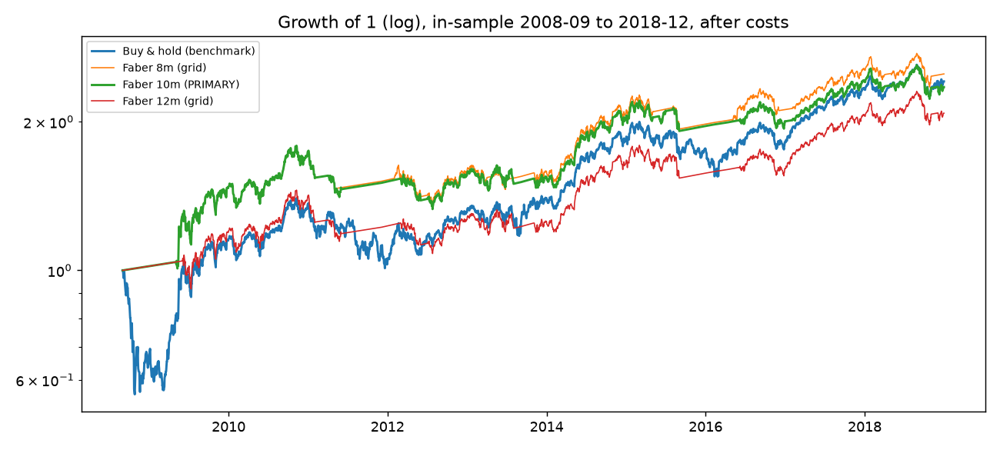
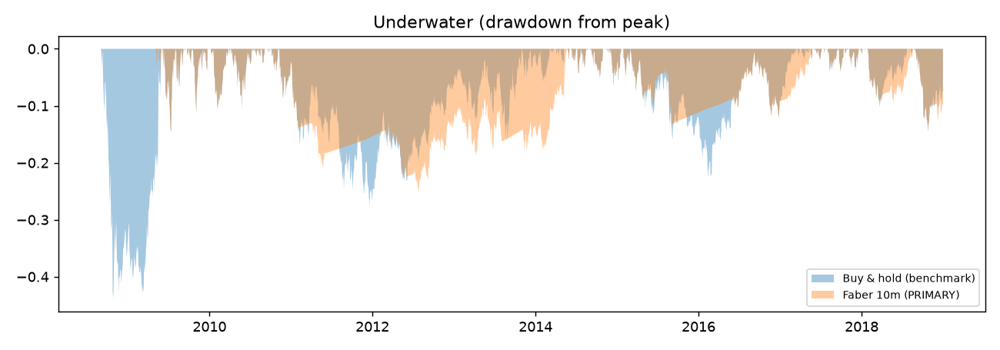
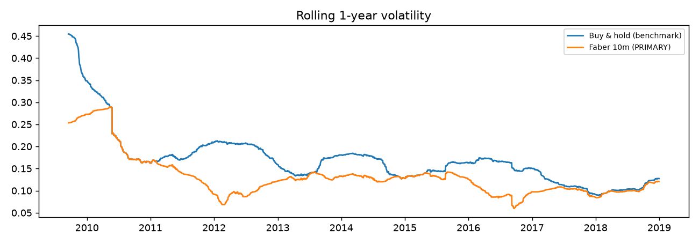

# In-sample report: Faber trend overlay on NIFTY 50

Generated 2026-10-31 08:10 · window 2007-09-17 → 2018-12-31 (2760 sessions) · holdout 2019-01-01+ SEALED

- **Evaluation starts 2008-09-01**: the first session on which every variant (longest = 12m) has a real signal. All runs hold 0 before it. Unaligned, the primary's max-DD advantage would read +34.2 pp vs +18.3 pp aligned: the gap is warm-up luck, not skill.
- Pre-registration: NOT CHECKED (no --prereg given): demo mode only
- Trade series: INDEX STAND-IN (not tradable: replace with NSE-rebuilt NIFTYBEES before Gate 3)
- Cash: OECD monthly India rates, lagged 1 month (see 06_data notes; 2007-09→2011-10 provisional)
- Costs: 5 bps/side slippage + NSE statutory (nse_costs.py, rates as of 2026-10-31 applied to the past)
- Bootstrap: stationary, mean block 20 sessions, 2000 paired resamples, seed 17

## 1. Every pre-registered run (all count as trials)

|                        | CAGR   | vol   |   sharpe_xs | max_dd   |   calmar |   longest_underwater_days |   sharpe_se_iid | exposure   |   trades |   turnover_x_per_yr |   cost_drag_bps_per_yr | costs_inr   | interest_inr   |
|:-----------------------|:-------|:------|------------:|:---------|---------:|--------------------------:|----------------:|:-----------|---------:|--------------------:|-----------------------:|:------------|:---------------|
| Buy & hold (benchmark) | 8.9%   | 20.7% |        0.19 | -43.9%   |     0.2  |                      1086 |            0.32 | 100.0%     |        2 |                0.06 |                      0 | ₹198        | ₹57,710        |
| Faber 8m (grid)        | 9.3%   | 14.0% |        0.22 | -24.3%   |     0.38 |                      1279 |            0.32 | 67.0%      |       22 |                1.93 |                     13 | ₹4,538      | ₹464,134       |
| Faber 10m (PRIMARY)    | 8.6%   | 14.2% |        0.18 | -25.6%   |     0.34 |                      1289 |            0.32 | 70.4%      |       22 |                2.12 |                     13 | ₹5,038      | ₹414,481       |
| Faber 12m (grid)       | 7.4%   | 13.1% |        0.09 | -25.6%   |     0.29 |                      1289 |            0.32 | 72.9%      |       14 |                1.19 |                      9 | ₹2,418      | ₹320,736       |

Interest and costs in ₹ cover the whole run, warm-up included. Sharpe is excess of the cash series. `sharpe_se_iid` is the IID large-sample SE (Lo 2002); bootstrap bands below are the ones to quote.

## 2. Primary vs benchmark, with 90% bootstrap bands

| Statistic | Point | 90% band |
|---|---|---|
| Sharpe (xs cash), primary | 0.18 | -0.32 to 0.64 |
| Sharpe (xs cash), buy & hold | 0.19 | -0.34 to 0.74 |
| Vol ratio (primary / B&H) | 0.69 | 0.56 to 0.81 |
| Max-DD difference (primary − B&H) | +18.3 pp | -0.4 pp to +40.3 pp |
| CAGR give-up (primary − B&H) | -0.3 pp | -9.7 pp to +9.1 pp |
| P(DD shallower than B&H) | | 94% |

## 3. Calendar years (total return; first year is partial)

|      |   Buy & hold (benchmark) |   Faber 8m (grid) |   Faber 10m (PRIMARY) |   Faber 12m (grid) |
|-----:|-------------------------:|------------------:|----------------------:|-------------------:|
| 2008 |                    -34.2 |               2   |                   2   |                2   |
| 2009 |                     75.8 |              44.8 |                  44.8 |               17.7 |
| 2010 |                     17.9 |              17.9 |                  17.9 |               17.9 |
| 2011 |                    -24.6 |             -12.4 |                 -13.1 |              -13.1 |
| 2012 |                     27.7 |               4   |                   3   |                2.9 |
| 2013 |                      6.8 |               0.2 |                  -0.7 |               -0.7 |
| 2014 |                     31.4 |              31.4 |                  31.3 |               31.3 |
| 2015 |                     -4.1 |              -5.2 |                  -3.5 |               -4.7 |
| 2016 |                      3   |               7   |                   2.2 |                2.2 |
| 2017 |                     28.6 |              21.1 |                  21.1 |               28.6 |
| 2018 |                      3.2 |              -2.5 |                  -3.1 |                0.6 |

## 4. Regimes (total return)

|                                        |   Buy & hold (benchmark) |   Faber 8m (grid) |   Faber 10m (PRIMARY) |   Faber 12m (grid) |
|:---------------------------------------|-------------------------:|------------------:|----------------------:|-------------------:|
| GFC crash (from eval start to 2009-03) |                    -32.9 |               3.4 |                   3.4 |                3.4 |
| Recovery & taper (2009-04 to 2013-12)  |                    106   |              53.5 |                  49.5 |               21.5 |
| 2014 to 2018                           |                     74.6 |              59.5 |                  54   |               67.8 |

## 5. Trial accounting

- Variants run today: 4 (1 benchmark + 3 pre-registered Faber lengths)
- Effective number of independent Faber trials (eigenvalue participation ratio): 1.15
- From trial-log.csv: {"total_trials_logged": 1, "trials_in_family": 1, "sharpe_var_in_family": null, "note": "Day 20 DSR uses N = trials_in_family (or effective N, justified) and this variance."}

## 6. What this report is NOT

- Not a test. Every number above was seen during design (Days 8 to 12). The holdout on Day 20 is the test.
- Not a reason to change the primary. Grid rows are for the Day 18 stability check, not for picking a winner.

