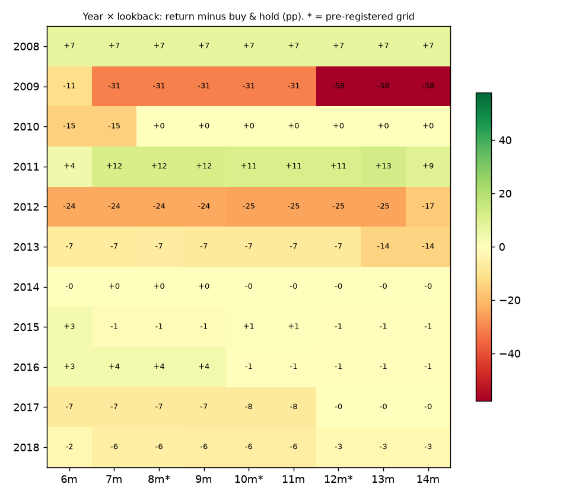
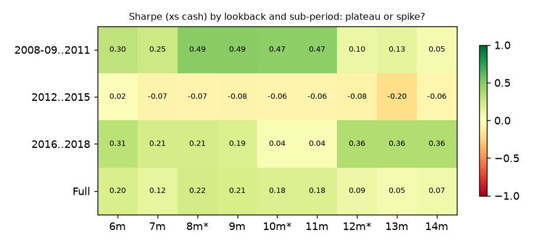
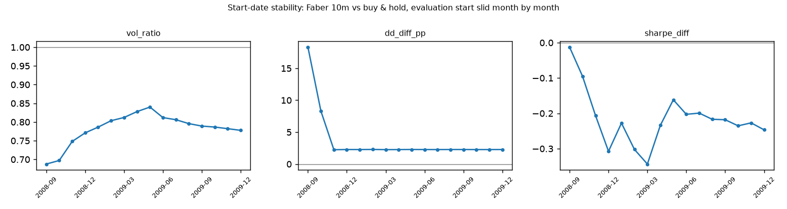
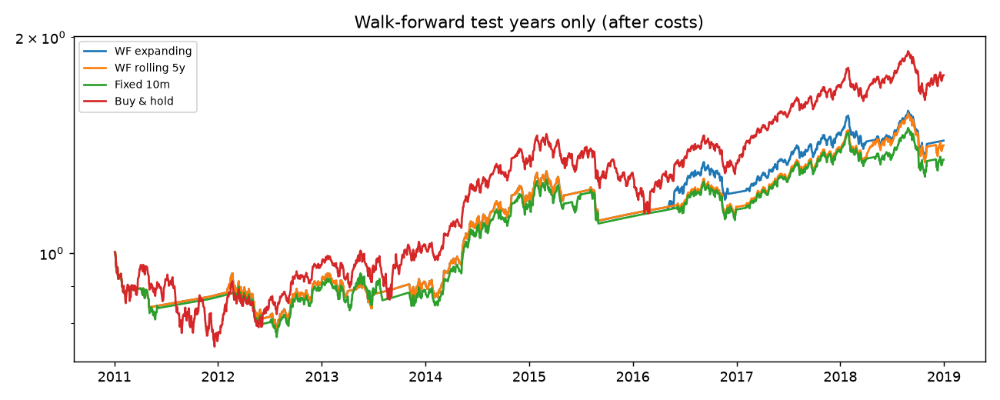

# Stability report: Faber trend overlay (exploration window)

Window 2008-11-03 → 2018-12-31 (common start for lookbacks up to 14m) · test years for WF: 2011 to 2018 · switch cost 13.9 bps × |Δw|

## 1. Walk-forward: re-picking the best length every January vs sticking with the pre-registered one

|                                  | CAGR   | vol   |   sharpe_xs | max_dd   |
|:---------------------------------|:-------|:------|------------:|:---------|
| WF expanding (re-pick each Jan)  | 4.8%   | 11.1% |       -0.19 | -22.5%   |
| WF rolling 5y (re-pick each Jan) | 4.6%   | 11.2% |       -0.2  | -22.5%   |
| Fixed 10m (pre-registered)       | 4.0%   | 11.5% |       -0.24 | -23.9%   |
| Buy & hold                       | 7.7%   | 15.5% |        0.08 | -26.2%   |
| Fixed 8m (hindsight check)       | 4.8%   | 11.1% |       -0.19 | -22.5%   |
| Fixed 12m (hindsight check)      | 5.1%   | 11.8% |       -0.14 | -23.9%   |

Picks each January:

|      | expanding   | rolling   |
|-----:|:------------|:----------|
| 2011 | 8m          | 8m        |
| 2012 | 8m          | 8m        |
| 2013 | 8m          | 8m        |
| 2014 | 8m          | 8m        |
| 2015 | 8m          | 8m        |
| 2016 | 8m          | 10m       |
| 2017 | 8m          | 8m        |
| 2018 | 8m          | 12m       |

Walk-forward efficiency (OOS annual return ÷ IS annual return of the pick): expanding 0.38, rolling 0.43

## 2. Heat map: year × lookback (return minus buy & hold, pp)

Rank of each pre-registered length per year (1 = best):

|      |   8 |   10 |   12 |
|-----:|----:|-----:|-----:|
| 2008 |   2 |    2 |    2 |
| 2009 |   1 |    1 |    3 |
| 2010 |   2 |    2 |    1 |
| 2011 |   1 |    2 |    3 |
| 2012 |   1 |    2 |    3 |
| 2013 |   1 |    3 |    2 |
| 2014 |   1 |    2 |    3 |
| 2015 |   3 |    1 |    2 |
| 2016 |   1 |    3 |    2 |
| 2017 |   2 |    3 |    1 |
| 2018 |   2 |    3 |    1 |

## 3. Neighbourhood plateau (Sharpe xs cash; DIAGNOSTIC: every cell is a trial)

|               |    6 |     7 |     8 |     9 |    10 |    11 |    12 |    13 |    14 |
|:--------------|-----:|------:|------:|------:|------:|------:|------:|------:|------:|
| 2008-09..2011 | 0.3  |  0.25 |  0.49 |  0.49 |  0.47 |  0.47 |  0.1  |  0.13 |  0.05 |
| 2012..2015    | 0.02 | -0.07 | -0.07 | -0.08 | -0.06 | -0.06 | -0.08 | -0.2  | -0.06 |
| 2016..2018    | 0.31 |  0.21 |  0.21 |  0.19 |  0.04 |  0.04 |  0.36 |  0.36 |  0.36 |
| Full          | 0.2  |  0.12 |  0.22 |  0.21 |  0.18 |  0.18 |  0.09 |  0.05 |  0.07 |

Plateau summary: {"primary_sharpe": 0.177, "neighbours_mean": 0.142, "neighbours_min": 0.05, "neighbours_max": 0.222, "primary_rank": 4, "n_cols": 9, "share_beating_bh": 0.0}

## 4. Hansen SPA: does the best grid member beat buy & hold after allowing for the search?

p-values (lower, consistent, upper): {"lower": 0.553, "consistent": 0.908, "upper": 0.908}

## 5. Start-date stability (same strategy, evaluation start slid month by month)

|         |   vol_ratio |   dd_diff_pp |   sharpe_diff |
|:--------|------------:|-------------:|--------------:|
| 2008-09 |        0.69 |        18.31 |         -0.01 |
| 2008-10 |        0.7  |         8.3  |         -0.1  |
| 2008-11 |        0.75 |         2.25 |         -0.21 |
| 2008-12 |        0.77 |         2.27 |         -0.31 |
| 2009-01 |        0.79 |         2.27 |         -0.23 |
| 2009-02 |        0.8  |         2.29 |         -0.3  |
| 2009-03 |        0.81 |         2.26 |         -0.34 |
| 2009-04 |        0.83 |         2.27 |         -0.23 |
| 2009-05 |        0.84 |         2.28 |         -0.16 |
| 2009-06 |        0.81 |         2.27 |         -0.2  |
| 2009-07 |        0.81 |         2.27 |         -0.2  |
| 2009-08 |        0.8  |         2.28 |         -0.22 |
| 2009-09 |        0.79 |         2.28 |         -0.22 |
| 2009-10 |        0.79 |         2.27 |         -0.24 |
| 2009-11 |        0.78 |         2.27 |         -0.23 |
| 2009-12 |        0.78 |         2.27 |         -0.25 |

Vol ratio range 0.69 to 0.84 · DD difference range +2.2 to +18.3 pp · Sharpe difference range -0.34 to -0.01

## 6. Trial accounting

- Variants run today: 3 grid + 6 neighbourhood + 2 WF schemes = **11**. Add them to trial-log.csv.
- None of these may replace the pre-registered primary. Day 18 asks whether the result depends on the pick, not which pick is best.

