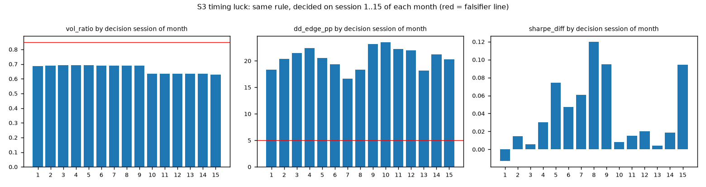
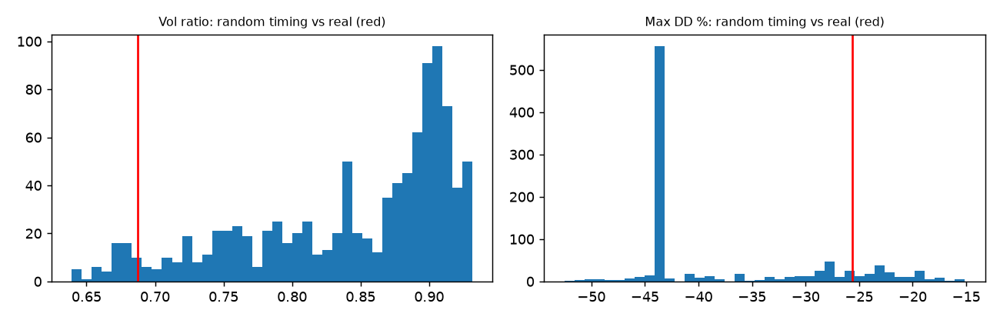
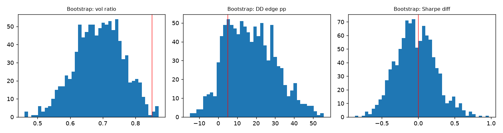

# Stress report: Faber overlay (exploration window)

Window 2008-09-01 → 2018-12-31 · rule 10m · falsifier lines: vol ratio ≤ 0.85, DD edge ≥ 5.0 pp (PLACEHOLDERS unless you passed your pre-registered values)

## Scenario table

|                              | CAGR   | vol   |   sharpe_xs | max_dd   |   vol_ratio |   dd_edge_pp |   sharpe_diff | vol_falsifier       | dd_falsifier        |
|:-----------------------------|:-------|:------|------------:|:---------|------------:|-------------:|--------------:|:--------------------|:--------------------|
| Base (pre-registered)        | 8.9%   | 14.2% |        0.18 | -25.6%   |        0.69 |         18.3 |         -0.01 | survives            | survives            |
| S1 costs ×2                  | 8.8%   | 14.2% |        0.17 | -25.9%   |        0.69 |         18.1 |         -0.02 | survives            | survives            |
| S1 costs ×3                  | 8.6%   | 14.2% |        0.16 | -26.1%   |        0.69 |         17.9 |         -0.03 | survives            | survives            |
| S2 delay +1 bar              | 9.3%   | 14.3% |        0.2  | -23.6%   |        0.69 |         20.3 |          0.01 | survives            | survives            |
| S2 delay +2 bar              | 9.2%   | 14.3% |        0.19 | -22.4%   |        0.69 |         21.5 |          0.01 | survives            | survives            |
| S2 delay +5 bar              | 9.9%   | 14.3% |        0.24 | -24.5%   |        0.69 |         19.4 |          0.05 | survives            | survives            |
| S3 timing luck: worst day    | 10.1%  | 14.3% |        0.25 | -27.2%   |        0.69 |         16.7 |          0.06 | survives            | survives            |
| S4 drop best 1 of 11 trades  | 5.8%   | 9.9%  |       -0.09 | -14.9%   |        0.48 |         29   |         -0.28 | n/a (return stress) | n/a (return stress) |
| S4 drop best 3 of 11 trades  | 3.2%   | 7.8%  |       -0.47 | -14.9%   |        0.38 |         29   |         -0.65 | n/a (return stress) | n/a (return stress) |
| S4 drop best 5 of 11 trades  | 3.1%   | 6.2%  |       -0.61 | -14.5%   |        0.3  |         29.4 |         -0.8  | n/a (return stress) | n/a (return stress) |
| S4 drop best 10 of 11 trades | 5.9%   | 2.7%  |       -0.46 | -11.5%   |        0.13 |         32.4 |         -0.65 | n/a (return stress) | n/a (return stress) |
| S5 drop best 5 days          | 5.7%   | 12.9% |       -0.05 | -25.6%   |        0.62 |         18.3 |         -0.24 | n/a (return stress) | n/a (return stress) |
| S5 drop best 10 days         | 4.0%   | 12.7% |       -0.18 | -25.6%   |        0.61 |         18.3 |         -0.37 | n/a (return stress) | n/a (return stress) |
| S6 cash rate −1 pp           | 8.6%   | 14.2% |        0.22 | -26.3%   |        0.69 |         17.6 |         -0.01 | survives            | survives            |

## S3 Timing luck (decision session 1–15)

|   session |   vol_ratio |   dd_edge_pp |   sharpe_diff |
|----------:|------------:|-------------:|--------------:|
|         1 |        0.69 |        18.31 |         -0.01 |
|         2 |        0.69 |        20.33 |          0.01 |
|         3 |        0.69 |        21.48 |          0.01 |
|         4 |        0.69 |        22.4  |          0.03 |
|         5 |        0.69 |        20.56 |          0.07 |
|         6 |        0.69 |        19.39 |          0.05 |
|         7 |        0.69 |        16.66 |          0.06 |
|         8 |        0.69 |        18.37 |          0.12 |
|         9 |        0.69 |        23.18 |          0.09 |
|        10 |        0.64 |        23.54 |          0.01 |
|        11 |        0.64 |        22.22 |          0.02 |
|        12 |        0.64 |        22.02 |          0.02 |
|        13 |        0.64 |        18.15 |          0    |
|        14 |        0.63 |        21.23 |          0.02 |
|        15 |        0.63 |        20.29 |          0.09 |

Range: DD edge +16.7 to +23.5 pp · vol ratio 0.63 to 0.69

## S7 Random-timing null (circular shifts of the real weight path)

Time in market 70%. Real vol ratio 0.69 vs random-timing median 0.87 (share of random paths at least as low: 0.06). Real max DD -25.6% vs random median -43.8% (share at least as shallow: 0.16).

## S8 Stationary bootstrap (mean block 20 days)

5/50/95%: vol ratio [0.56, 0.69, 0.81] · DD edge pp [-2.0, 16.2, 40.1] · Sharpe diff [-0.46, -0.06, 0.44]
Share of resamples where the falsifier is met: vol 99% · DD 80%

## Trial accounting

Stress runs are NOT new strategy trials (no rule changed, nothing is selectable). Log them as 'stress' rows, counted_in_dsr = no.